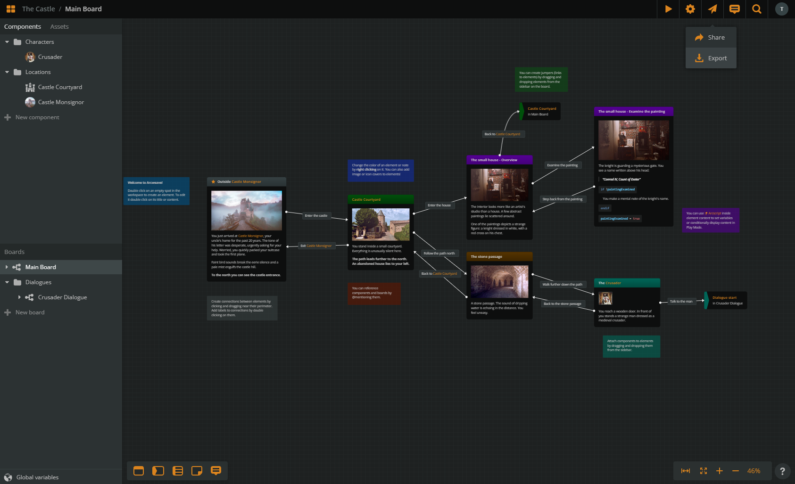
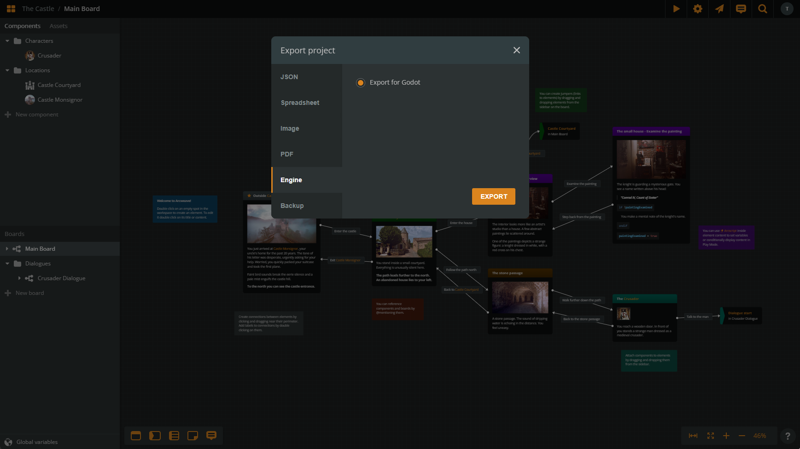

# Arcweave Godot Plugin

Arcweave Godot Plugin is a plugin for importing Arcweave Projects from [arcweave.com](https://arcweave.com/) in Godot and using them in your Projects.

The Arcweave Godot Export feature is available to all Arcweave users, including the Free accounts. The API import feature is available to the Team tier.

## Table of Contents

- [Arcweave Godot Plugin](#arcweave-godot-plugin)
  - [Installing the Plugin](#installing-the-plugin)
  - [Getting data from Arcweave](#getting-data-from-arcweave)
    - [Folder Import](#folder-import)
    - [API Import](#api-import)
  - [Creating an ArcweaveAsset](#creating-an-arcweaveasset)
    - [Loading the Project Data](#loading-the-project-data)
    - [Downloading Media](#downloading-media)
    - [Using the ArcweaveAsset](#using-the-arcweaveasset)
      - [Use ArcweaveNode](#use-arcweavenode)
      - [Create your own Node](#create-your-own-node)
    - [Your API Key](#your-api-key)
      - [Upgrading from 3.1 and older](#upgrading-from-31-and-older)
  - [Our Implementation](#our-implementation)
  - [Using the Plugin](#using-the-plugin)
    - [Scoped variables](#scoped-variables)
    - [C#](#c)
    - [GDScript](#gdscript)
  - [API Documentation](#api-documentation)
    - [Story class](#story-class)
      - [Properties](#properties)
      - [Methods](#methods)
    - [Project class](#project-class)
      - [Properties](#properties-1)
      - [Methods](#methods-1)

---

## Installing the Plugin

In order to use the plugin, you will need the **.NET** version of **Godot Engine** which you can find [here](https://godotengine.org/).

Download [`ArcweaveForGodot.zip`](https://github.com/arcweave/arcweave-godot-plugin/releases/latest/download/ArcweaveForGodot.zip) from the latest [GitHub release](https://github.com/arcweave/arcweave-godot-plugin/releases/latest) and extract it in your project's root folder. This adds the plugin as `addons/arcweave`. When upgrading, delete the previous `addons/arcweave` folder first, so files removed from the plugin don't stay behind.

> Note: The zip only contains the plugin. If you want our test project as well, clone this repo.

If you haven't already, create a C# solution for your project, through `Project` -> `Tools` -> `C#` -> `Create C# Solution`. This will create two files in your root folder with the name of your project and with extensions `.csproj` and `.sln`.

Open the `.csproj` file, and after the `PropertyGroup` part, add the following:

```xml
<ItemGroup>
    <PackageReference Include="Antlr4.Runtime.Standard" Version="4.13.1" />
</ItemGroup>
```

So the file will now look similar to this:

```xml
<Project Sdk="Godot.NET.Sdk/4.4.0">
  <PropertyGroup>
    <TargetFramework>net8.0</TargetFramework>
    <EnableDynamicLoading>true</EnableDynamicLoading>
  </PropertyGroup>
  <ItemGroup>
    <PackageReference Include="Antlr4.Runtime.Standard" Version="4.13.1" />
  </ItemGroup>
</Project>
```

This will add a required library for the plugin which handles the interpretation of **Arcscript**.

Then:
- Reload your project from `Project` -> `Reload Current Project`
- Build your Project using the top right build pickaxe icon (or press `Alt + B`)
- Go to `Project` -> `Project Settings` -> `Plugins` and enable it.

## Getting data from Arcweave

You can import your project in two ways, using our API or by downloading the Godot Export and selecting the exported file

### Folder Import

To use the Folder Import you will have to download the Godot Engine Export for your Arcweave Project.

In your Arcweave Project select the Export Option from the top right corner



Then Select the Engine Tab and Download the Export file for Godot.



Save the exported file.

### API Import

Feature available to Team account holders only. You can fetch your Arcweave project's data from within Godot, via Arcweave's web API.

To do this, you will need:

* your **API key** as an Arcweave user.
* your **project's hash**.

[This chapter](https://arcweave.com/docs/1.0/api) in the Arcweave Documentation explains where to find both of them.

## Creating an ArcweaveAsset

Either way, to import your data into Godot, you must create an **ArcweaveAsset** in your Godot project. To do this, right-click on your Godot FileSystem tab, select **New Resource** and find the **ArcweaveAsset** option and pick the file name of your choice. 

### Loading the Project Data

Open the newly created resource's inspector. You will see two options for selecting either a file or use the Arcweave API to retrieve the data.

- **Importing from JSON**: Click on **Select Project File**, find your downloaded export file and select it.
- **Importing from API**: Fill the **API Key** and **Project Hash** values. The API key isn't saved in the resource, see [Your API Key](#your-api-key).

Then click on **Initialize Arcweave Asset** button. This will either load the project from the file, or fetch the data from the API and store it's info in the Resource.

### Downloading Media

When importing from the API, you can also download the images and audio your project uses. Enable **Download Media** in the API Settings of the resource and click on **Initialize Arcweave Asset**. The plugin downloads the element and component covers, the element audio and the assets of asset list attributes into a `<Resource Name> Media` folder next to the resource, showing the progress in a dialog where you can cancel the download.

The files are named after your Arcweave assets, for example `ArcweaveAsset Media/castle.jpeg`. Characters that file names can't contain are replaced with `_`, long names are shortened, and assets with the same name get a number, like `castle 2.jpeg`. A file keeps its name once it is downloaded: renaming the asset in Arcweave updates the file in place, so the scenes that use it keep working. You can also rename or move the downloaded files in the FileSystem dock, and later downloads update them where they are.

- Supported files are `.png`, `.jpg`, `.jpeg`, `.webp`, `.svg`, `.bmp`, `.tga` images and `.mp3`, `.ogg`, `.wav` audio. Other files, such as `.gif`, are skipped with a warning.
- Initializing again only rewrites the files that changed, and deletes the files your project no longer uses. Media that fails to download keeps its previous copy.
- The plugin only replaces or deletes the files it downloaded, while they still have the contents it downloaded. Your own files, and downloaded files you edited, are never overwritten or deleted. A duplicated resource downloads its own media.
- The resource references the downloaded media, so the media is loaded with the resource, included when you export it, and stays linked when you move the files. Disabling **Download Media** and initializing again unlinks it, keeping the files.
- Downloads happen in the editor only. Initializing from the API during runtime keeps the media downloaded in the editor.

**Download Media** is disabled by default. The downloaded media is linked to the project's assets through `Asset.LocalPath`, and `Asset.LoadResource()` loads it, for example as a `Texture2D` for images or an `AudioStream` for audio:

```csharp
var cover = element.Cover?.LoadResource() as Texture2D;
```

If you create the Story yourself, pass the downloaded media to it with `new Story(projectSettings, (Dictionary)ArcweaveAsset.Call("get_media_paths"))`.

### Using the ArcweaveAsset

You can use ArcweaveAsset in your own way. Use a separate node for the Arcweave Project, integrate it on your own,
or you can use the **ArcweaveNode** we are providing.

#### Use ArcweaveNode

This plugin creates a new **ArcweaveNode** type, that you can use in your scenes to integrate your Arcweave Project
in your game.

Add an **ArcweaveNode** as a child node in your scene and use the Inspector tab connect it to your resource that you created earlier.

This Node has 3 properties:

- ArcweaveAsset
- Story
- ApiRequest

The **Story** is the class that handles the Arcweave Project. It stores all the info regarding your project and it's
the way we are interacting with it.

**ApiRequest** is an instance of a Node that is being added as a child of ArcweaveNode. It handles the connection to
the Arcweave API for requesting and retrieving the updated Arcweave Project.

#### Create your own Node

You can also create your own nodes and interact with the ArcweaveAsset. 

In order to update during runtime though, you would have to add an [`APIRequest`](./addons/arcweave/Editor/APIRequestScript.gd) node to your scene, created with `APIRequest.new(arcweave_asset)`. It adds an HTTPRequest node to your scene to make the requests. You can see how we implemented owr own [`ArcweaveNode.cs`](./addons/arcweave/Editor/ArcweaveNode.cs) for C# or [`gd_script_scene_no_arcweave_node.gd`](./scripts/gd_script_scene_no_arcweave_node.gd) for GDScript and follow a similar pattern.

### Your API Key

The **API Key** field in the ArcweaveAsset inspector isn't saved in the resource, since the resource is committed to version control and included in your exported game. It is saved for you only, in `user://arcweave_settings.cfg`, your Godot project's user data folder, which is outside the project folder. Each developer enters their own key, and it is used by all the ArcweaveAssets of the project.

Refreshes from the WebAPI use, in this order:

1. The key passed to the refresh, with `ArcweaveNode.UpdateStoryWithApiKey(apiKey)` or `arcweave_asset.refresh_project(api_request, api_key)`.
2. A key passed to the ArcweaveAsset's constructor, `ArcweaveAsset.new(project_settings, api_key, project_hash)`. It is never saved.
3. The key saved in the inspector.
4. The `ARCWEAVE_API_KEY` environment variable, for example on a build server.
5. A key saved in the resource by an older version of the plugin (see below).

The key saved in the inspector is used by all the ArcweaveAssets of the project. If ArcweaveAssets need different keys, for example for projects in different Arcweave workspaces, pass each one's key to the refresh.

A game run from the editor reads the same user data folder, so refreshing the story at runtime works without passing a key. An exported game on another computer doesn't have your key, so pass one to the refresh if it should refresh from the WebAPI. Initializing the ArcweaveAsset in the editor before exporting means the game doesn't need to refresh at all.

#### Upgrading from 3.1 and older

Older versions of the plugin saved the API key in the ArcweaveAsset resource. The plugin still reads and uses that key, and keeps it in the resource until you move it, so it isn't lost. The ArcweaveAsset inspector shows a warning with a **Move API Key Out of Resource** button, which moves the key to your user settings and saves the resource without it. If you already have the same key in your user settings or the `ARCWEAVE_API_KEY` environment variable, it is kept and the one in the resource is removed. If you have a different key, the plugin asks before removing the resource's key. An ArcweaveAsset saved inside a scene is removed from the scene file when you save the scene.

Exporting a game that includes an ArcweaveAsset that still contains a key, in its own file or saved inside a scene or another resource, shows a warning. The key also stays in your version control history, so consider generating a new key in Arcweave if the repository is shared.

## Our Implementation

Most of our implementation, except ArcweaveAsset and some editor GDScript classes, is written in C#. The project classes use Godot types (`Godot.Collections.Dictionary`, `Godot.Collections.Array` and `Variant`), so GDScript can use them directly, for example `story.GenerateCurrentOptions().Paths`. Members that use plain C# types can't be called from GDScript; the API tables below mark them **C# only**.

## Using the Plugin

Using Godot's functionality for [Cross-language scripting](https://docs.godotengine.org/en/stable/tutorials/scripting/cross_language_scripting.html) you can use the plugin both from GDScript and C# Godot Projects. The only limitation is using the *.NET*  version of Godot Engine.

In this repo we are providing a simple Demo of both implementations.

### Scoped variables

Boolean, integer, float, and plain-string attributes can be used as Arcscript variables when both the attribute and its owning board or component have custom IDs. The attribute custom ID is the member name, while the board or component custom ID is its scope:

```arcscript
health = 100
castle.health = 10
hero.health = 20
```

Unqualified names resolve global variables only. Scoped variables can be retrieved and changed from C# with `GetScopedVariable(name, scope)` and `SetScopedVariable(name, scope, value)`. The existing `GetVariable(name)` API remains global-only. `GetAllVariables()` enumerates every scope, while `SetVariableById(id, value)` applies changes using the stable Arcweave variable or attribute ID.

Variable saves and `Story.GetVariableChanges()` use stable IDs as keys so repeated member names remain distinct across scopes. Projects must be exported from a compatible Arcweave version after its board variables have been migrated to attributes.

### C#

<details>
<summary>How to use the plugin in a C# Godot Project</summary>

<br/>

The main Class that the user should use is the [**Story**](#story) class of the plugin. This has most of the functionalities needed to traverse through a Project. Story is stored as a property inside our ArcweaveNode so our examples are based on that.

To start a Project's Story you have to initialize a Story instance with it's project settings, as well as an instance of APIRequest to be able to update your project on runtime. ArcweaveNode handles that in it's `_Ready` function, so if you are using this Node Type, you don't have to do it.

```csharp

public override void _Ready()
{
    Dictionary projectSettings = (Dictionary)ArcweaveAsset.Get("project_settings");
    Story = new Story(projectSettings);

    var requestScript = GD.Load<GDScript>("res://addons/arcweave/Editor/APIRequestScript.gd");
    ApiRequest = (Node)requestScript.New(ArcweaveAsset);
    AddChild(ApiRequest);
}
```

During the initialization, the data is loaded, the starting_element is set and the Element Options are generated.

If you have a text container you can use the `Story.GetCurrentRuntimeContent()` function to get the text of the current element and set it. In our Demo project, we have a function called `Repaint()` that updates our TextContainer with the new content.

```csharp
private void Repaint()
{
    TextContainer.Text = ArcweaveNode.Story.GetCurrentRuntimeContent();
}
```

You can also use `Story.GenerateCurrentOptions()` function to get the options of the current element:

```csharp
private void Repaint()
{
    TextContainer.Text = ArcweaveNode.Story.GetCurrentRuntimeContent();
    AddOptions();
}

private void AddOptions()
{
    // Empty the previous options
    foreach (var b in OptionContainer.GetChildren())
    {
        OptionContainer.RemoveChild(b);
    }
    // Retrieve the current options
    Options options = ArcweaveNode.Story.GenerateCurrentOptions();
    // Null if the story has no current element
    if (options?.Paths != null)
    {
        foreach (var path in options.Paths)
        {
            if (path.IsValid)
            {
                Button button = CreateButton(path);
                OptionContainer.AddChild(button);
            }
        }
    }
}
```

To select a certain option and continue the story path, we add a signal handler for the button in `CreateButton` that we used earlier, where we select the Path that we provided using `Story.SelectPath()`. When the new path is selected, we call the repaint function to recreate our UI. 

```csharp
private Button CreateButton(IPath path)
{
    Button button = new Button();
    button.Text = path.label;
    button.Pressed += () => OptionButtonPressed(path);

    return button;
}

private void OptionButtonPressed(IPath path)
{
    ArcweaveNode.Story.SelectPath(path as Path);
    Repaint();
}
```
</details>

### GDScript

<details>
<summary>How to use the plugin in a GDScript Godot Project</summary>

<br/>

The main Class that the user should use is the [**Story**](#story) class of the plugin. This has most of the functionalities needed to traverse through a Project. Story is stored as a property inside our ArcweaveNode so our examples are based on that.

To start a Project's Story you have to initialize a Story instance with it's project settings, as well as an instance of APIRequest to be able to update your project on runtime. ArcweaveNode handles that in its `_ready` function, so if you are using this Node Type, you don't have to do it.

```gdscript
# Your ArcweaveAsset resource file
var arcweave_asset: ArcweaveAsset = preload("res://ArcweaveAsset.tres")
var api_request: APIRequest
var Story = load("res://addons/arcweave/Story.cs")
var story

func _ready():
	api_request = APIRequest.new(arcweave_asset)
	arcweave_asset.project_updated.connect(_on_project_updated)
	add_child(api_request)

	story = Story.new(arcweave_asset.project_settings)

```

During the initialization, the data is loaded, the starting_element is set and the Element Options are generated.

If you have a text container (here, a RichTextLabel node saved as `text_window`) you can use the `story.GetCurrentRuntimeContent()` function to get the text of the current element and set it. In our Demo project, we have a function called `repaint()` that updates our TextContainer with the new content.

Element content, connection labels, rich text attributes and notes are converted to BBCode, so enable `bbcode_enabled` on the RichTextLabel. Bold, italic, underline and strikethrough become `[b]`, `[i]`, `[u]` and `[s]`, line breaks and paragraphs become new lines, and code blocks are colored. Other tags are removed, and HTML entities such as `&amp;` are decoded. Square brackets are passed through unchanged, so BBCode you write in Arcweave text, such as `[color=red]…[/color]` or `[wave]…[/wave]`, is rendered.

```gdscript
func repaint():
	text_window.text = story.GetCurrentRuntimeContent()
```

You can also use `story.GenerateCurrentOptions()` function to get the options of the current element:

```gdscript
func repaint():
	text_window.text = story.GetCurrentRuntimeContent()
	add_options()

func add_options():
	for option in options_container.get_children():
		options_container.remove_child(option)
		option.queue_free()
	
	var options = story.GenerateCurrentOptions()
	var paths = options.Paths if options != null else null
	if paths != null:
		for path in paths:
			if path.IsValid:
				var button : Button = create_button(path)
				options_container.add_child(button)
```

To select a certain option and continue the story path, we add a signal handler for the button in `create_button` that we used earlier, where we select the Path that we provided using `story.SelectPath()`. When the new path is selected, we call the repaint function to recreate our UI. 

```gdscript
func create_button(path):
	var button : Button = Button.new()
	button.text = path.label
	button.pressed.connect(option_button_pressed.bind(path))
	return button

func option_button_pressed(path):
	story.SelectPath(path)
	repaint()
```
</details>

## API Documentation

The tables list the public API that games use. The Story and Project classes are in C# (namespaces `Arcweave` and `Arcweave.Project`); ArcweaveAsset and APIRequest are GDScript classes.

### Story class

A Story plays an Arcweave project: it keeps the current element, the element visits and the variable values.

#### Properties

| Property                          | Description                                                                     |
| :-------------------------------- | :------------------------------------------------------------------------------ |
| `VariableChanges VariableChanges` | Tracks the variable changes of the last element. `GetVariableChanges()` returns them |

Use `GetProject()` and `GetCurrentElement()` to get the project and the current element.

#### Methods

| Method Name | Description |
| :---------- | :---------- |
| `Story(Dictionary projectData)` | Creates a Story from the project data and goes to the starting element |
| `Story(Dictionary projectData, Dictionary mediaPaths)` | Like the above, linking the downloaded media (`ArcweaveAsset.get_media_paths()`) to the project's assets |
| `Story UpdateStory(Dictionary projectData)` | Updates the story with new project data, keeping the visits and the current element if it still exists, and going to the starting element otherwise. Variables keep the values they had before the current element: the changes of its content and of the connection labels that led to it are undone, and the content of the current element is run again. Returns the story |
| `Story UpdateStory(Dictionary projectData, Dictionary mediaPaths)` | Like the above, linking the downloaded media |
| `void ResetStory()` | Resets the variables to their default values and the visits to 0, and goes to the starting element |
| `void SetCurrentElementById(string id)` | Goes to the element with the ID. If there is none, reports an error and stays on the current element |
| `void SetCurrentElement(Element element)` | Goes to the element. If it is null, reports an error and stays on the current element |
| `Element GetCurrentElement()` | Returns the current element, or null if the project has no starting element and none was set. Use it to check whether the story has a current element |
| `string GetCurrentRuntimeContent()` | Returns the current element's content as BBCode, after running its scripts. Without a current element it returns null in C#, which GDScript receives as `""` |
| `Options GenerateCurrentOptions()` | Returns the current element's options. Their `Paths` is null if the element has no outputs. Null without a current element |
| `void SelectPath(Path path)` | Runs the path's connection labels and goes to its target element. If the path has no target element, reports an error and stays on the current element |
| `Project GetProject()` | Returns the project |
| `Dictionary<string, Dictionary<string, Variant>> GetVariableChanges()` | Returns the variables the last element changed, by stable variable ID, each with its `"oldValue"` and `"newValue"` |
| `Dictionary<string, Variant> GetSave()` | Returns a save of the current element ID (`"currentElement"`), the variable values (`"variables"`) and the visits (`"visits"`) |
| `void LoadSave(Dictionary<string, Variant> save)` | Loads a save made with `GetSave()` |

### Project class

#### Properties

| Property                                   | Description                                                            |
| :----------------------------------------- | :--------------------------------------------------------------------- |
| `string Name`                              | The project's name                                                     |
| `Dictionary<string, Board> Boards`         | The boards of the project, by ID                                       |
| `Dictionary<string, Component> Components` | The components of the project, by ID                                   |
| `Array<Variable> Variables`                | The global variables of the project. Board and component variables are in their `Variables` |
| `Dictionary<string, Element> Elements`     | The elements of the project, by ID                                     |
| `Dictionary<string, Asset> Assets`         | The assets of the project, by ID                                       |
| `Element StartingElement`                  | The starting element of the project, or null if it has none            |
| `string StartingElementId`                 | The starting element's ID in the project data, also when no element has it. Empty if none is set |

#### Methods

| Method Name | Description |
| :---------- | :---------- |
| `Element ElementWithId(string id)` | Returns the element with the ID, or null |
| `Dictionary<string, Board> GetBoards()` | Returns the boards of the project, by ID |
| `Variable GetVariable(string name)` | Returns the global variable with the name, or null |
| `Variable GetScopedVariable(string name, string scope)` | Returns the variable with the name of the board or component whose custom ID is `scope`, or null |
| `Variable GetVariableById(string id)` | Returns the global, board or component variable with the stable ID, or null |
| `IEnumerable<Variable> GetAllVariables()` | Returns the global, board and component variables. **C# only** |
| `bool SetVariable(string name, object value)` | Sets the global variable with the name. Returns false if there is no such variable or the value is null or of an unsupported type. **C# only** |
| `bool SetScopedVariable(string name, string scope, object value)` | Like `SetVariable`, for the variable of the board or component whose custom ID is `scope`. **C# only** |
| `bool SetVariableById(string id, object value)` | Like `SetVariable`, for the variable with the stable ID. **C# only** |
| `void ResetVariables()` | Resets all the variables to their default values |
| `void ResetVisits()` | Resets the visits of all the elements to 0 |
| `Dictionary<string, Variant> SaveVariables()` | Returns the values of all the variables, by stable ID |
| `void LoadVariables(Dictionary<string, Variant> save)` | Loads variable values saved with `SaveVariables()` |

### ArcweaveNode class

| Member | Description |
| :----- | :---------- |
| `GodotObject ArcweaveAsset` | The ArcweaveAsset the node plays |
| `Story Story` | The node's Story, created when the node is ready |
| `signal ProjectUpdated()` | Emitted after a refresh updated the Story |
| `void UpdateStory()` | Refreshes the project with the ArcweaveAsset's receive method. A WebAPI refresh uses the API key saved in the inspector, otherwise the `ARCWEAVE_API_KEY` environment variable |
| `void UpdateStoryWithApiKey(string apiKey)` | Like `UpdateStory()`, refreshing from the WebAPI with the API key, eg. in an exported game. An empty key finds the key like `UpdateStory()` |
| `Story CreateStory()` | Creates a new Story from the ArcweaveAsset's project settings |

### ArcweaveAsset class (GDScript)

| Member | Description |
| :----- | :---------- |
| `signal project_updated(project_settings)` | Emitted when a refresh ends, with the new project settings, or with null if the refresh failed |
| `Dictionary project_settings` | The project data, passed to `Story` |
| `String receive_method` | `"File"` or `"WebAPI"` |
| `String project_file` | The JSON file exported from Arcweave, for the `"File"` method |
| `String project_hash` | The project's hash, for the `"WebAPI"` method |
| `bool download_media` | Download the project's media when initializing from the WebAPI in the editor |
| `refresh_project(api_request: APIRequest, api_key := "")` | Reloads the project from the file or the WebAPI and emits `project_updated`. `api_key` is the key a WebAPI refresh uses. When empty, the key is found as described in [Your API Key](#your-api-key) |
| `Dictionary get_media_paths()` | Returns the downloaded media that still exists, by Arcweave asset ID |
| `bool has_legacy_api_key()` | Returns true if the resource contains an API key saved by an older version of the plugin |

### APIRequest class (GDScript)

A Node that requests the project from Arcweave's web API. Create it with `APIRequest.new(arcweave_asset)` and add it to the scene tree, then pass it to `ArcweaveAsset.refresh_project()`.

## Running the Tests

The tests in [`tests`](./tests) run in headless Godot, since the plugin's classes need the engine. With the .NET version of Godot 4.4 and the .NET 8 SDK, run from the repository folder:

```bash
dotnet build CSharp_Plugin.csproj
godot --headless --path . --import
godot --headless --path . --script res://tests/run_tests.gd
```

The last command prints each test and exits with 1 if any test fails. The tests aren't part of the plugin package.
